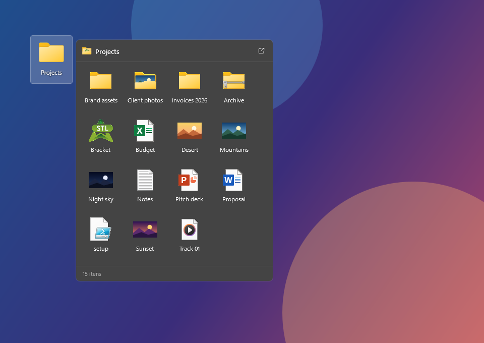

<div align="center">


# FolderPeek

**Peek inside desktop folders without opening them.**<br/>
Click a folder (or hover over it) on your Windows desktop and a Windows 11-style popup shows what's inside.

[](https://github.com/DingyS8/FolderPeek/actions/workflows/build.yml)
[](https://github.com/DingyS8/FolderPeek/releases/latest)
[](https://github.com/DingyS8/FolderPeek/releases)


[](LICENSE)

<a href="https://github.com/DingyS8/FolderPeek/releases/latest"><b>⬇️ Download FolderPeek.exe</b></a>
&nbsp;·&nbsp;
<a href="README.pt-BR.md">🇧🇷 Leia em português</a>

<br/><br/>



</div>

## ✨ Features

- 🖱️ **Single click or hover**: click a folder once, or rest the mouse on it for 1.5 s. You pick the trigger in the tray menu.
- 🪟 **Feels native**: real Windows 11 acrylic blur, rounded corners, system shadow and your **accent color**. Falls back to a solid look on Windows 10.
- 🖼️ **Real thumbnails** for photos, videos, PDFs and 3D files (`.stl`, `.3mf`), and native icons for everything else.
- 📂 **Browse without leaving the desktop**: click subfolders to step inside, use ← to go back, or click any part of the **breadcrumb path**.
- ⚡ **Never steals focus**: the popup doesn't activate, so whatever you were typing in stays focused.
- 🧠 **Closes when you're done**: it fades out once the mouse leaves both the icon and the popup, with a forgiving gap between them.
- 🔗 Works with **folder shortcuts** (`.lnk`) too.
- 🙈 Respects Explorer's settings: hidden files, protected system files and *hide extensions*.
- ☁️ **OneDrive-safe**: cloud-only placeholder files are never read, so peeking never triggers a download.
- 🪶 Light on resources: a 50 ms cursor poll costs ~0% CPU, and nothing is injected into `explorer.exe`.

## 🚀 Getting started

1. Download **`FolderPeek.exe`** from the [latest release](https://github.com/DingyS8/FolderPeek/releases/latest). It's one self-contained file, so you don't need to install .NET.
2. Run it. A folder icon appears in the system tray.
3. Click any folder on your desktop. That's it.

> [!NOTE]
> The exe isn't code-signed yet, so Windows SmartScreen may say *"Windows protected your PC"*. Click **More info → Run anyway**. You can also build it yourself from source (see below).

### Using it

| Action | Result |
|---|---|
| Click a folder on the desktop | Opens the preview |
| Double-click | Opens the folder normally (the preview closes) |
| Click a **file** in the preview | Opens it |
| Click a **subfolder** in the preview | Navigates into it |
| **Ctrl+click** a subfolder | Opens it in File Explorer |
| ↗ button in the header | Opens the current folder in File Explorer |
| Hover an item | Shows full name, size and date in the footer |
| Drag icons, or Ctrl/Shift+click | Ignored, so desktop selection works as usual |

### Tray menu

Right-click the tray icon to:
- **pause** (or double-click the icon)
- choose the trigger: *click*, *hover* or *both*
- set the hover delay (0.5–3 s)
- **start with Windows**
- open the logs folder

Settings live in `%APPDATA%\FolderPeek\settings.json`.

> [!NOTE]
> The interface is currently in Brazilian Portuguese. Translations are welcome (see *Contributing*).

## 🛠️ Build from source

Requires the [.NET 10 SDK](https://dotnet.microsoft.com/download).

```powershell
git clone https://github.com/DingyS8/FolderPeek.git
cd FolderPeek
dotnet build -c Release
.\bin\Release\net10.0-windows\win-x64\FolderPeek.exe
```

Single self-contained exe (the same file the release ships):

```powershell
dotnet publish -c Release --self-contained -p:PublishSingleFile=true -p:IncludeNativeLibrariesForSelfExtract=true -o publish
```

### Diagnostics

| Command | What it does |
|---|---|
| `FolderPeek.exe --verbose` | Logs every step to `%LOCALAPPDATA%\FolderPeek\folderpeek.log` |
| `FolderPeek.exe --diag` | Matches every desktop icon (UI Automation × IFolderView) without moving the mouse, and writes `diag.txt` |
| `FolderPeek.exe --preview "C:\folder" [x y]` | Shows the popup for 15 s at the cursor (or at `x y`) |
| `FolderPeek.exe --thumb "C:\photo.jpg" out.png [px]` | Renders a thumbnail exactly as the popup does |

## 🔍 How it works

```
DispatcherTimer 50 ms ─► GetCursorPos + WindowFromPoint
                         └─ is it SysListView32 ⊂ SHELLDLL_DefView ⊂ Progman/WorkerW?  (if not: do nothing)
   click (WH_MOUSE_LL, forward-only) or hover timeout
                                │
                                ▼  background thread
              UI Automation: desktop ListView items → bounding-rect hit test
              IShellWindows.FindWindowSW(SWC_DESKTOP) → IShellBrowser → IFolderView
                         └─ match by position + name → PIDL → full path
                         └─ folder, or a .lnk (IShellLinkW) pointing to a folder?
                                │
                                ▼  UI thread
              PreviewWindow (WPF, WS_EX_NOACTIVATE, DWM acrylic)
                         └─ IShellItemImageFactory thumbnails on a dedicated STA thread
```

Design notes:
- **Polling instead of a global hook for hover.** A low-level hook slows down the whole system's mouse if its thread stalls.
- **Click detection uses a forward-only `WH_MOUSE_LL` hook** on its own thread. It never blocks or swallows input, and it exists only while click mode is on.
- **No `AutomationElement.FromPoint`.** Fullscreen transparent overlays (such as the NVIDIA GeForce overlay) win that hit test, so FolderPeek hit-tests the desktop ListView's own item rectangles instead.
- **No injection, no reading another process's memory.** That keeps antivirus software happy.
- **Per-Monitor V2 DPI**: cursor, rectangles and window placement are all in physical pixels.

## ⚠️ Known limitations

- Mouse-wheel scrolling relies on *"Scroll inactive windows when hovering over them"*, which is on by default.
- Virtual items (Recycle Bin, This PC) and `.zip` files don't open a preview.
- Emoji in file names render monochrome (a WPF limitation).
- There's no right-click context menu on preview items yet.

## 🤝 Contributing

Issues and pull requests are welcome! Good first contributions:
- an English/multi-language UI
- a context menu on items
- `.zip` preview

Please open an issue before starting a large change.

## 📄 License

[MIT](LICENSE). Use it, fork it, ship it.
