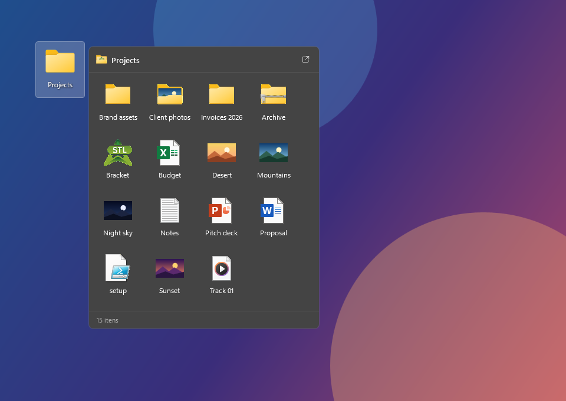

<div align="center">


# FolderPeek

**Espie dentro das pastas da Área de Trabalho sem abri-las.**<br/>
Clique numa pasta (ou pare o mouse em cima dela) e aparece um popup no estilo Windows 11 mostrando o que tem dentro.

[](https://github.com/DingyS8/FolderPeek/actions/workflows/build.yml)
[](https://github.com/DingyS8/FolderPeek/releases/latest)


[](LICENSE)

<a href="https://github.com/DingyS8/FolderPeek/releases/latest"><b>⬇️ Baixar FolderPeek.exe</b></a>
&nbsp;·&nbsp;
<a href="README.md">🇺🇸 Read in English</a>

<br/><br/>



</div>

## ✨ Recursos

- 🖱️ **Clique único ou hover**: clique uma vez na pasta, ou pare o mouse 1,5 s em cima. Você escolhe o gatilho na bandeja.
- 🪟 **Cara de Windows**: acrílico real do Windows 11 (desfoque do fundo), cantos arredondados, sombra do sistema e a sua **cor de destaque**. No Windows 10 o fundo fica sólido.
- 🖼️ **Miniaturas reais** de fotos, vídeos, PDFs e arquivos 3D (`.stl`, `.3mf`), e ícones nativos para o resto.
- 📂 **Navegue sem sair do desktop**: clique em subpastas para entrar, use ← para voltar, ou clique em qualquer parte do **caminho** no cabeçalho.
- ⚡ **Não rouba o foco**: o popup nunca é ativado, então o que você estava digitando continua em foco.
- 🧠 **Fecha sozinho** (com fade) quando o mouse sai do ícone e do popup. Há um corredor de tolerância entre os dois.
- 🔗 Funciona com **atalhos de pasta** (`.lnk`).
- 🙈 Respeita as opções do Explorer: arquivos ocultos, arquivos protegidos do sistema e *ocultar extensões*.
- ☁️ **Seguro com OneDrive**: arquivos que só existem na nuvem nunca são lidos, então espiar não dispara download.
- 🪶 Leve: o polling de 50 ms custa ~0% de CPU, e nada é injetado no `explorer.exe`.

## 🚀 Como usar

1. Baixe o **`FolderPeek.exe`** da [última release](https://github.com/DingyS8/FolderPeek/releases/latest). É um arquivo único autocontido, então não precisa instalar o .NET.
2. Execute. Aparece um ícone de pasta na bandeja.
3. Clique numa pasta da Área de Trabalho. Pronto.

> [!NOTE]
> O exe ainda não tem assinatura digital, então o SmartScreen pode mostrar *"O Windows protegeu o computador"*. Clique em **Mais informações → Executar assim mesmo**. Se preferir, compile você mesmo a partir do código (veja abaixo).

| Ação | Resultado |
|---|---|
| Clique numa pasta do desktop | Abre o preview |
| Clique duplo | Abre a pasta normalmente (o preview fecha) |
| Clique num **arquivo** do preview | Abre o arquivo |
| Clique numa **subpasta** do preview | Navega dentro dela |
| **Ctrl+clique** numa subpasta | Abre no Explorador |
| Botão ↗ no cabeçalho | Abre a pasta atual no Explorador |
| Mouse sobre um item | Mostra nome completo, tamanho e data no rodapé |
| Arrastar ícones ou Ctrl/Shift+clique | Ignorado, então a seleção do desktop funciona normal |

Pelo menu da **bandeja** (botão direito) você pode:
- pausar (ou dar clique duplo no ícone)
- escolher o gatilho: clique, hover ou os dois
- ajustar o tempo de hover (0,5–3 s)
- marcar para **iniciar com o Windows**
- abrir a pasta de logs

As configurações ficam em `%APPDATA%\FolderPeek\settings.json`.

## 🛠️ Compilar

Requer o [.NET 10 SDK](https://dotnet.microsoft.com/download).

```powershell
git clone https://github.com/DingyS8/FolderPeek.git
cd FolderPeek
dotnet build -c Release
.\bin\Release\net10.0-windows\win-x64\FolderPeek.exe
```

Exe único autocontido (o mesmo arquivo da release):

```powershell
dotnet publish -c Release --self-contained -p:PublishSingleFile=true -p:IncludeNativeLibrariesForSelfExtract=true -o publish
```

### Diagnóstico

| Comando | O que faz |
|---|---|
| `FolderPeek.exe --verbose` | Log passo a passo em `%LOCALAPPDATA%\FolderPeek\folderpeek.log` |
| `FolderPeek.exe --diag` | Casa todos os ícones do desktop (UIA × IFolderView) sem mexer o mouse e grava `diag.txt` |
| `FolderPeek.exe --preview "C:\pasta" [x y]` | Mostra o popup por 15 s no cursor (ou em `x y`) |
| `FolderPeek.exe --thumb "C:\foto.jpg" saida.png [px]` | Gera a miniatura exatamente como o popup gera |

## 🔍 Como funciona

Veja o diagrama e as decisões de design no [README em inglês](README.md#-how-it-works). Em resumo:
- polling em vez de hook global para o hover
- hook `WH_MOUSE_LL` só de repasse para o clique
- hit-test nos retângulos dos itens do ListView do desktop (overlays como o da NVIDIA quebram o `AutomationElement.FromPoint`)
- `IFolderView` para obter o caminho
- nenhuma injeção em outro processo

## ⚠️ Limitações conhecidas

- A rolagem com a roda depende de *"Rolar janelas inativas ao passar o mouse"*, que vem ligado por padrão.
- Itens virtuais (Lixeira, Este Computador) e `.zip` não abrem preview.
- Emojis em nomes aparecem monocromáticos (limitação do WPF).
- Ainda não há menu de contexto (botão direito) nos itens.

## 🤝 Contribuindo

Issues e pull requests são bem-vindos! Para mudanças grandes, abra uma issue antes.

## 📄 Licença

[MIT](LICENSE).
